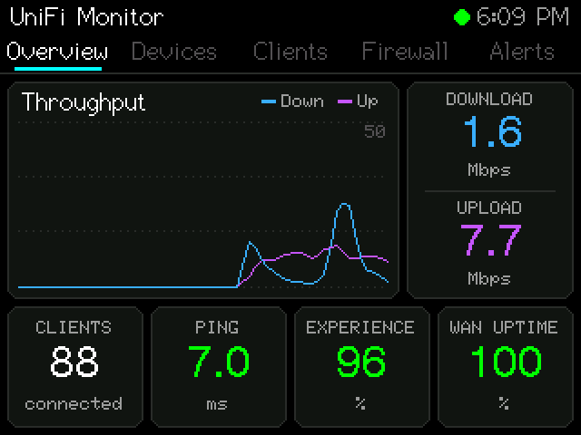
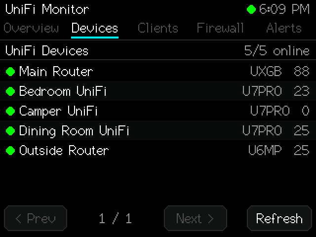
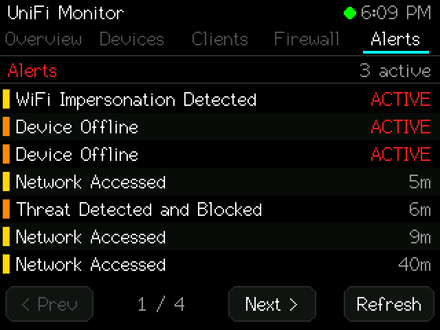
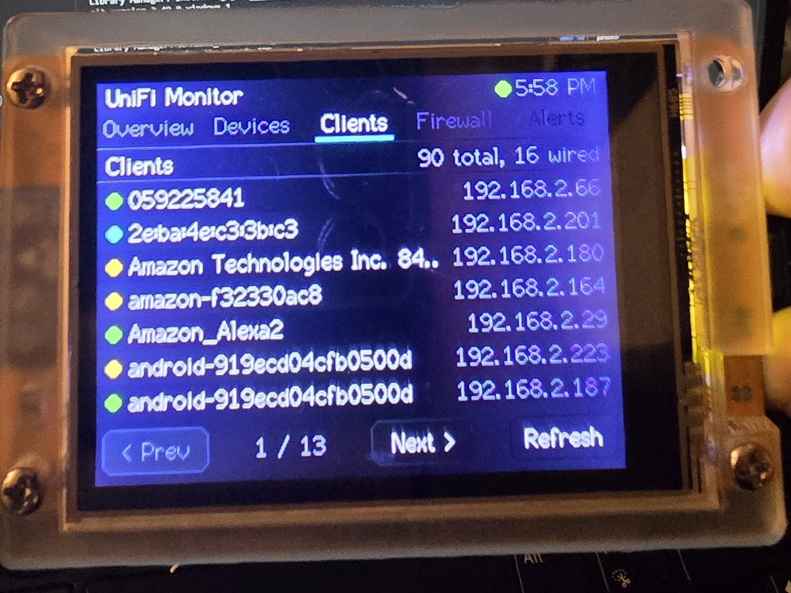
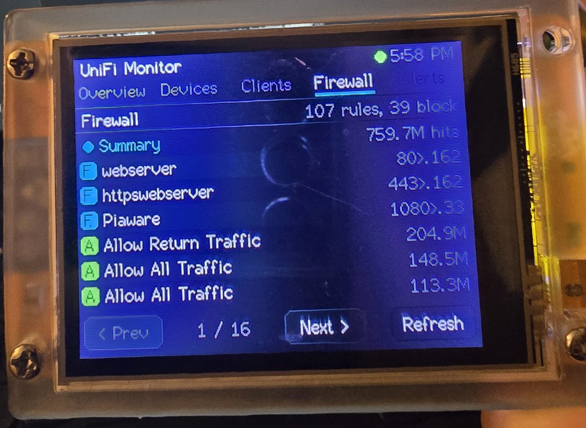
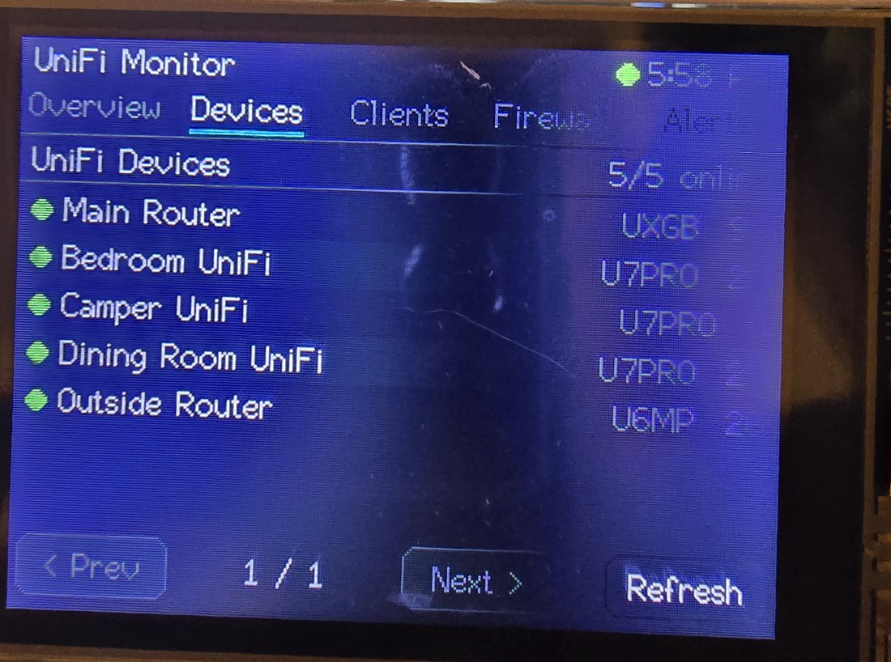
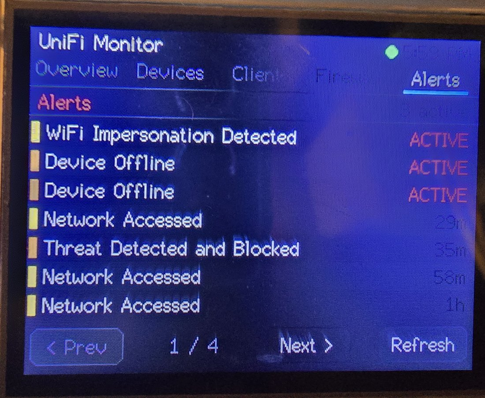

# CYD UniFi Monitor

A live dashboard for your UniFi network on a ~$15 ESP32 **"Cheap Yellow Display"** (CYD). Throughput, ping, clients, every UniFi device, firewall stats and alerts, on a little touchscreen that sits on your desk.

**[Install it from your browser →](https://nhscan.github.io/CYD-UniFi-Monitor/)** No software to install. Plug in the board, pick it from the list, click Install.

<p align="center">
  
  
  
</p>

<p align="center">
  
  
  
  
</p>

## What it shows

| Tab | Shows | Tap an item for |
|---|---|---|
| **Overview** | Live download/upload graph and speeds, connected clients, ping, WiFi experience, WAN uptime | |
| **Devices** | Every UniFi gateway, switch and access point with online status, model and client count | Firmware, uptime, CPU/memory/temperature, uplink, radio channels, port status |
| **Clients** | Everything connected, by name and IP, with WiFi signal (wired clients in cyan) | IP, MAC, vendor, SSID/port, signal, AP, network, data used, connected time |
| **Firewall** | Rule summary, your port forwards, then all firewall policies sorted by hit count | Action, zones, protocol, hits, last hit; port forward details |
| **Alerts** | Open alarms (rogue APs, offline devices…) and recent medium/high severity events | Full message, severity, category, time |

Everything comes straight from your UniFi console's local API. Nothing goes to the cloud.

## Supported boards

| Board | Screen | Status |
|---|---|---|
| ESP32-2432S028 "CYD2USB" (USB-C + micro-USB) | 2.8" 320×240 ST7789 | ✅ Tested |
| ESP32-2432S028R classic CYD (micro-USB only) | 2.8" 320×240 ILI9341 | Untested |
| ESP32-2432S024R | 2.4" 320×240 ILI9341 | Untested |
| ESP32-2432S032R | 3.2" 320×240 ST7789 | Untested |
| ESP32-3248S035R | 3.5" 480×320 ST7796 | Untested |

"Untested" boards are built from their published pinouts. If you try one, please [open an issue](https://github.com/Nhscan/CYD-UniFi-Monitor/issues) and say whether it worked, so the table can be updated. On boards whose touch shares the display bus (2.4", 3.2", 3.5"), you'll be asked to tap four corners once to calibrate. If colors look inverted, tick **Invert colors** on the setup page.

**You also need** a UniFi OS console on your network (UDM / UDM Pro / UDM SE, Cloud Gateway, Cloud Key Gen2, or similar) and 2.4 GHz WiFi.

## Setup

1. **Make a local UniFi account.** In UniFi go to *Settings → Admins & Users → Add Admin*, tick **Restrict to local access only**, and give it a password. Don't use your ui.com account; it has two-factor login, which the monitor can't do.
2. **Flash the firmware** from the [web installer](https://nhscan.github.io/CYD-UniFi-Monitor/) in desktop Chrome or Edge.
3. **Connect it.** The screen shows a WiFi network called `UniFi-Monitor-XXXX`. Join it from your phone. A setup page opens (or go to `http://192.168.4.1`). Enter your WiFi, your console's IP address, and the local account from step 1. Tap **Save**.

To change settings later, **hold your finger on the screen while it starts up**. If it can't join your WiFi, it opens the setup page on its own.

## Building from source

Install [VS Code](https://code.visualstudio.com) with the [PlatformIO](https://platformio.org/install/ide?install=vscode) extension, open this folder, then:

```sh
pio run -e cyd-2432s028-2usb -t upload    # build + flash one board (names are in platformio.ini)
pio run                                   # build every board
pio device monitor                        # serial log
```

To skip the setup page while developing, copy `include/credentials_template.h` to `include/credentials.h` (git-ignored), fill it in, and add `-D USE_CREDENTIALS_H` to `build_flags`.

Every push to `main` builds all boards with GitHub Actions and publishes the web installer (`tools/make_site.py` + `docs/`). Tagging `vX.Y.Z` also attaches the firmware files to a GitHub release.

### Project layout

```
src/main.cpp          boot, touch, overview screen
src/ui_pages.cpp      Devices / Clients / Firewall / Alerts list + detail screens
src/unifi_api.cpp     UniFi OS login + overview data
src/unifi_lists.cpp   device, client, firewall and alert fetching (streamed JSON)
src/settings.cpp      saved settings + setup hotspot
include/theme.h       colors and layout sizes
docs/                 web installer page + images
tools/                board list and site builder for the installer
```

## Troubleshooting

- **"UniFi login rejected":** check the username and password, and make sure it's a *local* account.
- **"Can't reach console":** use the console's LAN IP (the address you open UniFi at), not the gateway's public IP.
- **Nothing happens when flashing:** try another USB cable (many are charge-only), install the [CH340 driver](https://www.wch-ic.com/downloads/CH341SER_EXE.html), or hold **BOOT** while clicking Install.
- **Touch is off on a 2.4"/3.2"/3.5" board:** open setup (hold the screen at boot) and tick *Recalibrate touch*.

## Credits

Originally created by **Naseer Faheem** as a UniFi monitor for a 4" CYD. This version reworks it for the common 2.8"–3.5" CYD boards, adds the Devices/Clients/Firewall/Alerts screens, the setup hotspot and the web installer. Released under the [MIT License](LICENSE).

Not affiliated with Ubiquiti Inc. "UniFi" is a trademark of Ubiquiti Inc.
